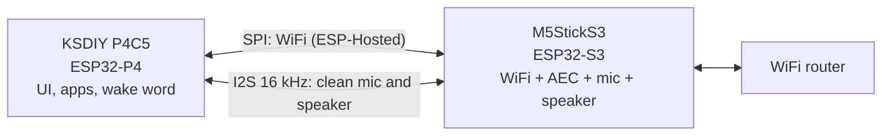

# KSDIY P4C5 + StickS3: an ESP32-S3 as WiFi and microphone co-processor for the ESP32-P4

English | [Tiếng Việt](README.vi.md)

> `p4c5_sticks3_coprocessor` = the **KSDIY ESP32-P4C5** board (P4C5) using an **M5StickS3** (ESP32-S3 chip) as its co-processor.

## What this is

The KSDIY P4C5 board has an ESP32-P4 (runs the UI and apps) and an ESP32-C5 that provides WiFi over SDIO. This project **replaces the C5 with an external M5StickS3** (ESP32-S3), wired to the board, to find out whether the S3 can take over two jobs:

1. **WiFi for the P4:** the S3 acts as a 2.4 GHz WiFi co-processor, connected to the P4 over SPI with ESP-Hosted 3.1.0.
2. **Microphone and speaker processing:** the S3 runs the AFE (acoustic echo cancellation, noise suppression, VAD) on the StickS3 microphone and sends the clean audio to the P4 over I2S; the StickS3 speaker plays the audio the P4 sends back.

Result: it works (WiFi about 10 to 13 Mbps, good AEC, I2S link stable for one hour), at the cost of BLE, 5 GHz WiFi and music quality. Details: [docs/RESULTS.md](docs/RESULTS.md).



The repository contains firmware for both chips, a phone app build that runs on this setup, the research documents and the measurement scripts.

## What you need to reproduce it

- One KSDIY P4C5 board and one M5StickS3, joined by 11 wires plus GND ([wiring diagram](docs/WIRING.md)).
- ESP-IDF 6.1 and a PC on the same 2.4 GHz WiFi network.

## Layout

| Folder | Contents |
| --- | --- |
| `cp_s3/` | S3 firmware: esp_hosted co-processor + `audio_fe` (ES8311, AFE FD HIGH, I2S link) |
| `host_p4/` | Test firmware for the P4: iperf over hosted, `linktest` and `linklat` commands for the I2S link |
| `afe_s3/` | Standalone AFE test on the StickS3 (tone, TTS speech, double-talk), used to pick the AFE configuration |
| `phone_s3/` | Slimmed-down phone (Brookesia, LVGL): Settings (WiFi, network test, volume), Music, Radio, Assistant |
| `hw_specs/` | P4C5 `hw_matrix.md`, StickS3 schematic and pin map |
| `tools/` | PC measurement scripts (soak, throughput, link, latency) |
| `docs/` | Results, architecture, wiring, link protocol, porting guide, measurement logs |

## Reading order

1. [docs/RESULTS.md](docs/RESULTS.md): what was gained, lost, the limits, what is not done.
2. [docs/ARCHITECTURE.md](docs/ARCHITECTURE.md): block diagram and data flow.
3. [docs/WIRING.md](docs/WIRING.md): wiring diagram and table.
4. [docs/I2S_LINK.md](docs/I2S_LINK.md): the I2S link protocol.
5. [docs/PORTING.md](docs/PORTING.md): porting to another P4 board.
6. [docs/logs/](docs/logs/): per-phase measurements; the scripts that produced them are in [tools/](tools/).

## Build

ESP-IDF 6.1. Each folder is an independent ESP-IDF project:

```bash
source ~/.espressif/tools/activate_idf_v6.1.sh
cd cp_s3    && idf.py set-target esp32s3 && idf.py build   # S3
cd host_p4  && idf.py set-target esp32p4 && idf.py build   # P4, test build
cd phone_s3 && idf.py set-target esp32p4 && idf.py build   # P4, phone build
```

`sdkconfig` is generated from `sdkconfig.defaults*` and is not in git. Flash with `idf.py -p <port> flash` (the S3 and the P4 are two different USB-Serial/JTAG ports; flashing or monitoring can reset a board).

## Notes

- esp_hosted 3.1.0 is required on both sides; it is not compatible with the stock C5 slave (2.12.13).
- `phone_s3` has a local BSP, `components/esp32p4c5_bsp`, which differs from the original GitHub BSP in WiFi (SPI to the S3) and audio (I2S link).
- The full phone (before slimming down and removing 4G) is not in this repository.
