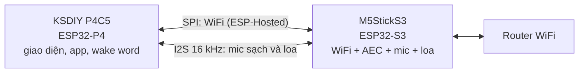

# KSDIY P4C5 + StickS3: dùng ESP32-S3 làm bộ WiFi và xử lý mic cho ESP32-P4

[English](README.md) | Tiếng Việt

> Tên `p4c5_sticks3_coprocessor` = board **KSDIY ESP32-P4C5** (P4C5) dùng **M5StickS3** (chip ESP32-S3) làm co-processor.

## Đây là gì

Board KSDIY P4C5 có ESP32-P4 (chạy giao diện và ứng dụng) và một ESP32-C5 làm WiFi qua SDIO. Dự án này **thay C5 bằng một M5StickS3** (ESP32-S3) nối ngoài bằng dây, để thử xem S3 có làm thay được hai việc:

1. **WiFi cho P4:** S3 làm co-processor WiFi 2,4 GHz, nối P4 qua SPI bằng ESP-Hosted 3.1.0.
2. **Xử lý mic và loa:** S3 chạy AFE (khử tiếng vọng AEC, khử nhiễu, VAD) trên mic của StickS3 rồi gửi tiếng sạch sang P4 qua I2S; loa của StickS3 phát âm thanh do P4 gửi sang.

Kết quả: làm được (WiFi khoảng 10 đến 13 Mbps, AEC tốt, link I2S ổn định 1 giờ), nhưng mất BLE, WiFi 5 GHz và chất lượng nhạc. Chi tiết: [docs/vi/RESULTS.md](docs/vi/RESULTS.md).



Repo gồm firmware cho cả hai chip, một bản phone chạy thử trên cấu hình này, tài liệu nghiên cứu và script đo.

## Cần gì để chạy lại

- 1 board KSDIY P4C5 và 1 M5StickS3, nối bằng 11 dây và GND ([sơ đồ đấu dây](docs/vi/WIRING.md)).
- ESP-IDF 6.1, PC cùng mạng WiFi 2,4 GHz.

## Cấu trúc

| Thư mục | Nội dung |
| --- | --- |
| `cp_s3/` | Firmware S3: esp_hosted co-processor + `audio_fe` (ES8311, AFE FD HIGH, link I2S) |
| `host_p4/` | Firmware thử trên P4: iperf qua hosted, lệnh `linktest` và `linklat` cho link I2S |
| `afe_s3/` | AFE độc lập trên StickS3 (tone, giọng TTS, double-talk) dùng để chọn cấu hình AFE |
| `phone_s3/` | Phone (Brookesia, LVGL) bản tinh giản: Cài đặt (WiFi, test mạng, âm lượng), Nhạc, Radio, Trợ lý |
| `hw_specs/` | `hw_matrix.md` của P4C5, schematic và pin map StickS3 |
| `tools/` | Script đo trên PC (soak, throughput, link, độ trễ) |
| `docs/` | Kết quả, kiến trúc, sơ đồ đấu dây, giao thức link, hướng dẫn port, log đo |

## Đọc theo thứ tự

1. [docs/vi/RESULTS.md](docs/vi/RESULTS.md): được gì, mất gì, hạn chế, chưa làm.
2. [docs/vi/ARCHITECTURE.md](docs/vi/ARCHITECTURE.md): sơ đồ khối và luồng dữ liệu.
3. [docs/vi/WIRING.md](docs/vi/WIRING.md): sơ đồ và bảng đấu dây.
4. [docs/vi/I2S_LINK.md](docs/vi/I2S_LINK.md): giao thức link I2S.
5. [docs/vi/PORTING.md](docs/vi/PORTING.md): port sang board P4 khác.
6. [docs/logs/vi/](docs/logs/vi/): số đo từng giai đoạn; script tạo ra chúng ở [tools/](tools/).

## Build

Dùng ESP-IDF 6.1. Mỗi project là một ESP-IDF project độc lập:

```bash
source ~/.espressif/tools/activate_idf_v6.1.sh
cd cp_s3    && idf.py set-target esp32s3 && idf.py build   # S3
cd host_p4  && idf.py set-target esp32p4 && idf.py build   # P4, bản thử
cd phone_s3 && idf.py set-target esp32p4 && idf.py build   # P4, bản phone
```

`sdkconfig` được sinh từ `sdkconfig.defaults*` và không nằm trong git. Nạp: `idf.py -p <cổng> flash` (S3 và P4 là hai cổng USB-Serial/JTAG khác nhau; nạp hoặc monitor có thể reset board).

## Ghi chú

- Cần esp_hosted 3.1.0 cho cả hai phía; không dùng chung với slave C5 stock (2.12.13).
- `phone_s3` có BSP cục bộ `components/esp32p4c5_bsp`, khác bản GitHub gốc ở WiFi (SPI tới S3) và âm thanh (link I2S).
- Bản đầy đủ của phone (trước khi tinh giản và gỡ 4G) không nằm trong repo này.
