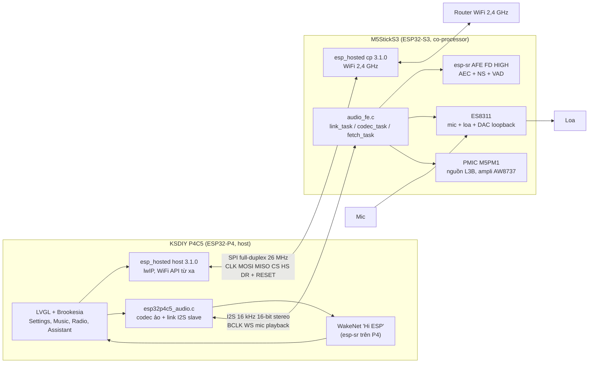

# Kiến trúc

Tiếng Việt | [English](en/ARCHITECTURE.md)

P4 (KSDIY P4C5) là host chạy giao diện, ứng dụng và wake word. M5StickS3 (ESP32-S3) là co-processor: WiFi cho P4 qua SPI, và làm sạch mic bằng AFE (AEC, khử nhiễu, VAD) rồi trả lại qua I2S. ESP32-C5 trên P4C5 không dùng (EN kéo thấp ở GPIO54).

## Sơ đồ khối

## Luồng dữ liệu

```mermaid
flowchart LR
    MIC["Mic ES8311"] --> AFE["AFE FD HIGH<br/>(mic + ref)"]
    REF["DAC loopback<br/>kênh R ES8311"] --> AFE
    AFE -->|"L = mic sạch<br/>R = bộ đếm"| LINKTX["I2S S3→P4"]
    LINKTX --> RX["link_task P4<br/>stream buffer mic"]
    RX --> WAKE["WakeNet / Opus encoder<br/>(Assistant)"]

    APP["Nhạc, radio, bíp, TTS"] --> VOL["software volume<br/>(esp_codec_dev, −24..−8 dB)"]
    VOL --> RS["resampler → 16 kHz mono"]
    RS --> PSB["stream buffer playback"]
    PSB -->|"L = playback<br/>R = magic 0xA55A"| LINKRX["I2S P4→S3"]
    LINKRX --> CODEC["codec_task S3"]
    CODEC --> DAC["ES8311 DAC → ampli → loa"]
    DAC --> REF
```

Quy ước chi tiết của khung I2S: [I2S_LINK.md](I2S_LINK.md).

## Phân chia CPU và bộ nhớ trên S3

| Core | Việc | Tải đo được (soak 1 giờ) |
| --- | --- | --- |
| 0 | WiFi, esp_hosted SPI, `link_task` I2S (ưu tiên 10) | trung bình 38%, đỉnh 58,6% |
| 1 | `codec_task` (đọc ES8311 và feed AFE), `fetch_task` (lấy ngõ ra AFE) | trung bình 45,5%, đỉnh 60,2% |

- esp-sr 2.6.2 giao diện V1 không có task AFE riêng, AEC và VAD chạy ngay trong `feed()` và `fetch()`, nên hai task này được ghim vào core 1.
- RAM nội tối thiểu khoảng 40 KB. Stream buffer của audio_fe và stack của `codec_task`, `fetch_task` đặt ở PSRAM. Stack task hosted là 6144, buffer WiFi đã giảm (RX động 16, TX động 16, RX tĩnh 8).
- S3 chỉ có FPU đơn: không dùng `double` trong vòng lặp nóng.

## Phía P4

- **WiFi:** `esp32p4c5_wifi.c` kéo GPIO54 (EN của C5) xuống thấp, rồi kết nối S3 bằng esp_hosted. Chỉ có WiFi 2,4 GHz, không BLE.
- **Âm thanh:** `esp32p4c5_audio.c` cung cấp `bsp_audio_codec_speaker_init()` và `bsp_audio_codec_microphone_init()` như BSP gốc, nhưng thiết bị phía sau là codec ảo (không có `codec_if`), dùng software volume của esp_codec_dev. Loa nhận PCM mono ở tần số bất kỳ và được hạ mẫu xuống 16 kHz.
- **Assistant:** `assistant_afe_open()` trả `false` khi `CONFIG_BSP_AUDIO_S3_LINK=y`: không chạy AFE trên P4. Wake word và bộ mã hóa Opus đọc mic sạch từ link.
- **Thông tin S3:** trang Cài đặt, Giới thiệu hiện các bộ đếm link (khung lỗi hoặc mất, underrun loa).
