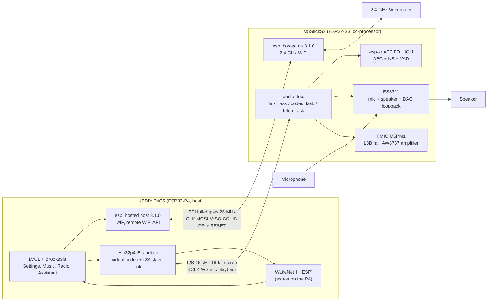

# Architecture

English | [Tiếng Việt](vi/ARCHITECTURE.md)

The P4 (KSDIY P4C5) is the host: it runs the UI, the apps and wake-word detection. The M5StickS3 (ESP32-S3) is the co-processor: it gives the P4 WiFi over SPI and cleans the microphone with the AFE (AEC, noise suppression, VAD), returning the result over I2S. The ESP32-C5 on the P4C5 is unused (its EN pin, GPIO54, is held low).

## Block diagram

## Data flow

```mermaid
flowchart LR
    MIC["ES8311 microphone"] --> AFE["AFE FD HIGH<br/>(mic + ref)"]
    REF["DAC loopback<br/>ES8311 R channel"] --> AFE
    AFE -->|"L = clean mic<br/>R = counter"| LINKTX["I2S S3 to P4"]
    LINKTX --> RX["P4 link_task<br/>mic stream buffer"]
    RX --> WAKE["WakeNet / Opus encoder<br/>(Assistant)"]

    APP["Music, radio, beep, TTS"] --> VOL["software volume<br/>(esp_codec_dev, −24..−8 dB)"]
    VOL --> RS["resampler to 16 kHz mono"]
    RS --> PSB["playback stream buffer"]
    PSB -->|"L = playback<br/>R = magic 0xA55A"| LINKRX["I2S P4 to S3"]
    LINKRX --> CODEC["S3 codec_task"]
    CODEC --> DAC["ES8311 DAC, amplifier, speaker"]
    DAC --> REF
```

Details of the I2S frame format: [I2S_LINK.md](I2S_LINK.md).

## CPU and memory split on the S3

| Core | Work | Measured load (1-hour soak) |
| --- | --- | --- |
| 0 | WiFi, esp_hosted SPI, I2S `link_task` (priority 10) | average 38%, peak 58.6% |
| 1 | `codec_task` (reads the ES8311 and feeds the AFE), `fetch_task` (takes the AFE output) | average 45.5%, peak 60.2% |

- The esp-sr 2.6.2 V1 interface has no AFE task of its own: AEC and VAD run inside `feed()` and `fetch()`, so those two tasks are pinned to core 1.
- Minimum internal RAM is about 40 KB. The audio_fe stream buffers and the stacks of `codec_task` and `fetch_task` live in PSRAM. The hosted task stack is 6144 and the WiFi buffers are reduced (dynamic RX 16, dynamic TX 16, static RX 8).
- The S3 has a single-precision FPU only: avoid `double` in hot loops.

## P4 side

- **WiFi:** `esp32p4c5_wifi.c` pulls GPIO54 (the C5's EN) low, then connects to the S3 with esp_hosted. WiFi 2.4 GHz only, no BLE.
- **Audio:** `esp32p4c5_audio.c` provides `bsp_audio_codec_speaker_init()` and `bsp_audio_codec_microphone_init()` like the original BSP, but the device behind them is a virtual codec (no `codec_if`) that uses the esp_codec_dev software volume. The speaker accepts mono PCM at any rate and downsamples it to 16 kHz.
- **Assistant:** `assistant_afe_open()` returns `false` when `CONFIG_BSP_AUDIO_S3_LINK=y`: no AFE runs on the P4. Wake word and the Opus encoder read the clean microphone from the link.
- **S3 info:** Settings, About shows the link counters (frame errors or losses, speaker underruns).
