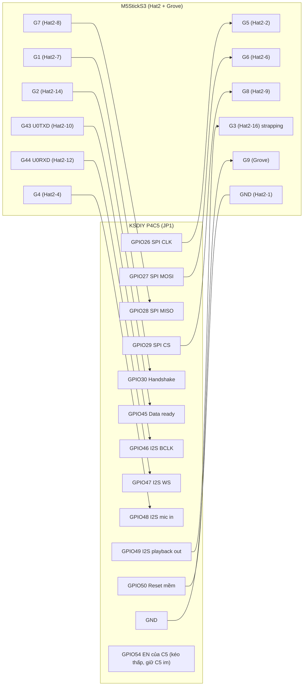

# Sơ đồ đấu dây

Hai board nối bằng 11 dây tín hiệu và GND. Phía P4C5 lấy từ header JP1 (11 GPIO trống: 26 đến 30 và 45 đến 50, mỗi chân qua điện trở nối tiếp 100 Ω). Phía StickS3 lấy từ header Hat2 và cổng Grove.

## Sơ đồ

Mũi tên chỉ hướng tín hiệu. S3 là master của I2S (cấp BCLK và WS), P4 là slave.

## Bảng nối dây

| Tín hiệu | P4C5 (JP1) | StickS3 | Chân Hat2 | Hướng | Ghi chú |
| --- | --- | --- | --- | --- | --- |
| SPI CLK | GPIO26 | G5 | 2 | P4 → S3 | 26 MHz |
| SPI MOSI | GPIO27 | G6 | 6 | P4 → S3 | |
| SPI MISO | GPIO28 | G7 | 8 | S3 → P4 | |
| SPI CS | GPIO29 | G8 | 9 | P4 → S3 | |
| Handshake | GPIO30 | G1 | 7 | S3 → P4 | |
| Data ready | GPIO45 | G2 | 14 | S3 → P4 | |
| Reset mềm | GPIO50 | G9 | Grove | P4 → S3 | S3 tự khởi động lại khi GPIO50 xuống thấp 2 ms trở lên (`EH_TRANSPORT_CP_SPI_GPIO_RESET`) |
| I2S BCLK | GPIO46 | G43 (U0TXD) | 10 | S3 → P4 | mất UART0 của S3 (console dùng USB-Serial/JTAG) |
| I2S WS | GPIO47 | G44 (U0RXD) | 12 | S3 → P4 | |
| I2S mic sạch | GPIO48 | G4 | 4 | S3 → P4 | L = mic sau AFE, R = bộ đếm |
| I2S playback | GPIO49 | G3 | 16 | P4 → S3 | G3 là chân strapping, chỉ dùng làm ngõ vào |
| GND | GND | GND | 1 | | |

## Chân không đụng trên StickS3

LCD G38 đến G41, G21 và G45; I2C của IMU và PMIC G47 và G48; ES8311 G14 đến G18; nút G11 và G12; IR G42 và G46; PMIC G13.

## Trên P4C5

- **C5 phải nằm im:** kéo GPIO54 (EN của C5) xuống thấp và không khởi tạo SDIO (GPIO14 đến 19).
- Bản đồ chân đầy đủ của P4C5 (LCD, camera, thẻ SD, codec, I2C): [../hw_specs/hw_matrix.md](../hw_specs/hw_matrix.md).
- Bản đồ chân StickS3 và schematic: [../hw_specs/StickS3_docs_pinmap.txt](../hw_specs/StickS3_docs_pinmap.txt), [../hw_specs/StickS3_schematic_V0.6.pdf](../hw_specs/StickS3_schematic_V0.6.pdf).

## Lưu ý khi nối

- Dây ngắn, dưới 10 cm; nên có GND xen kẽ với đường SPI. SPI ở cả hai phía đi qua GPIO matrix nên giới hạn xung: 26 MHz ổn định, 40 MHz không ổn định.
- **G3 là chân strapping** của S3. P4 nên để GPIO49 ở high-Z cho đến khi S3 chạy xong; khung playback chỉ hợp lệ khi có magic `0xA55A` ở kênh R (xem [I2S_LINK.md](I2S_LINK.md)).
- Reset P4 (kể cả do công cụ nạp hoặc monitor kéo DTR/RTS) cũng reset S3 qua GPIO50. Khi ghi log, mở cổng không kéo DTR/RTS (xem [../tools/README.md](../tools/README.md)).
- Kiểm tra mức 3,3 V của GPIO26 đến 30 và 45 đến 50 trên P4C5 (qua điện trở 100 Ω) và StickS3.
