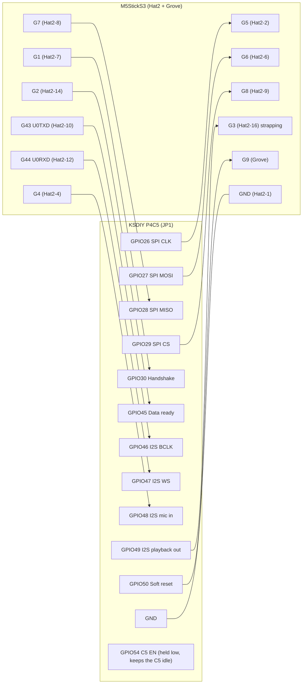

# Wiring

[Tiếng Việt](../WIRING.md) | English

The two boards are joined by 11 signal wires plus GND. On the P4C5 side the wires come from header JP1 (11 free GPIOs: 26 to 30 and 45 to 50, each through a 100 Ω series resistor). On the StickS3 side they come from the Hat2 header and the Grove port.

## Diagram

Arrows show signal direction. The S3 is the I2S master (it provides BCLK and WS); the P4 is the slave.

## Wiring table

| Signal | P4C5 (JP1) | StickS3 | Hat2 pin | Direction | Note |
| --- | --- | --- | --- | --- | --- |
| SPI CLK | GPIO26 | G5 | 2 | P4 to S3 | 26 MHz |
| SPI MOSI | GPIO27 | G6 | 6 | P4 to S3 | |
| SPI MISO | GPIO28 | G7 | 8 | S3 to P4 | |
| SPI CS | GPIO29 | G8 | 9 | P4 to S3 | |
| Handshake | GPIO30 | G1 | 7 | S3 to P4 | |
| Data ready | GPIO45 | G2 | 14 | S3 to P4 | |
| Soft reset | GPIO50 | G9 | Grove | P4 to S3 | The S3 restarts itself when GPIO50 is held low for 2 ms or more (`EH_TRANSPORT_CP_SPI_GPIO_RESET`) |
| I2S BCLK | GPIO46 | G43 (U0TXD) | 10 | S3 to P4 | the S3 loses UART0 (the console uses USB-Serial/JTAG) |
| I2S WS | GPIO47 | G44 (U0RXD) | 12 | S3 to P4 | |
| I2S clean mic | GPIO48 | G4 | 4 | S3 to P4 | L = mic after the AFE, R = counter |
| I2S playback | GPIO49 | G3 | 16 | P4 to S3 | G3 is a strapping pin, used as an input only |
| GND | GND | GND | 1 | | |

## StickS3 pins not to touch

LCD G38 to G41, G21 and G45; IMU and PMIC I2C G47 and G48; ES8311 G14 to G18; buttons G11 and G12; IR G42 and G46; PMIC G13.

## On the P4C5

- **The C5 must stay idle:** pull GPIO54 (the C5's EN) low and do not initialize SDIO (GPIO14 to 19).
- Full P4C5 pin map (LCD, camera, SD card, codec, I2C): [../../hw_specs/hw_matrix.md](../../hw_specs/hw_matrix.md).
- StickS3 pin map and schematic: [../../hw_specs/StickS3_docs_pinmap.txt](../../hw_specs/StickS3_docs_pinmap.txt), [../../hw_specs/StickS3_schematic_V0.6.pdf](../../hw_specs/StickS3_schematic_V0.6.pdf).

## Wiring notes

- Keep wires short, under 10 cm, and interleave GND with the SPI lines if possible. SPI on both sides goes through the GPIO matrix, which limits the clock: 26 MHz is stable, 40 MHz is not.
- **G3 is a strapping pin** of the S3. The P4 should keep GPIO49 high-impedance until the S3 is running; playback frames are only valid when the R channel carries the magic `0xA55A` (see [I2S_LINK.md](I2S_LINK.md)).
- Resetting the P4 (including a flashing or monitor tool driving DTR/RTS) also resets the S3 through GPIO50. When logging, open the port without driving DTR/RTS (see [../../tools/README.en.md](../../tools/README.en.md)).
- Check the 3.3 V level of GPIO26 to 30 and 45 to 50 on the P4C5 (behind the 100 Ω resistors) and on the StickS3.
