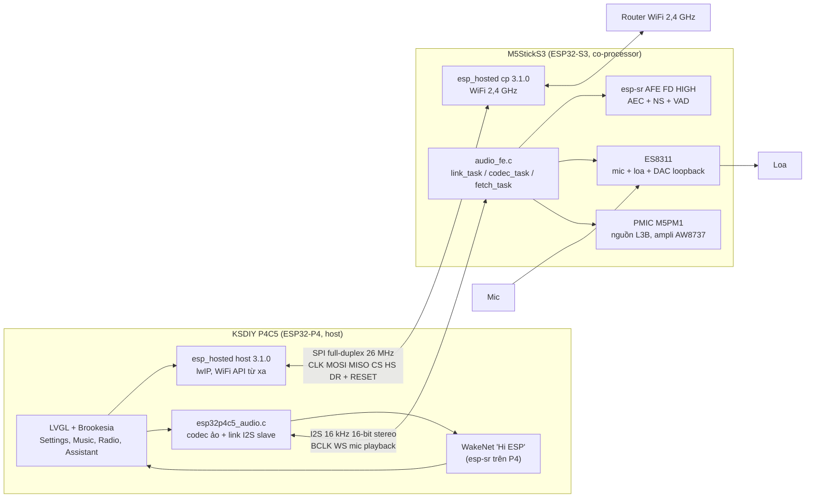
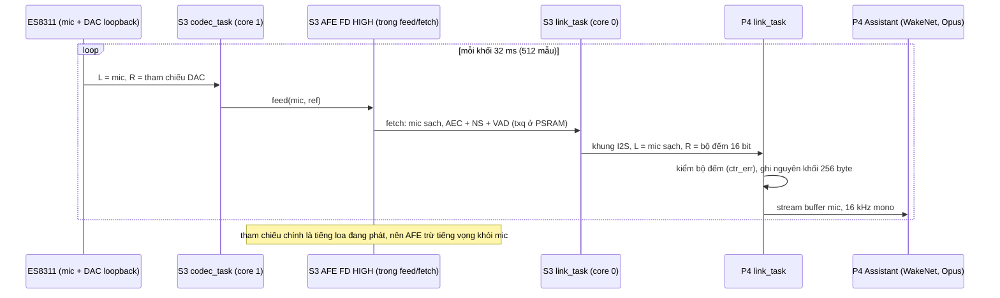
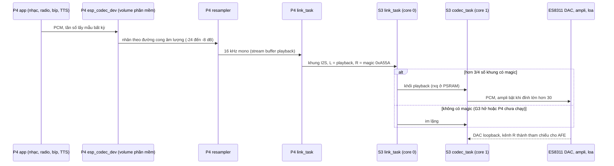

# Kiến trúc

[English](../ARCHITECTURE.md) | Tiếng Việt

P4 (KSDIY P4C5) là host chạy giao diện, ứng dụng và wake word. M5StickS3 (ESP32-S3) là co-processor: WiFi cho P4 qua SPI, và làm sạch mic bằng AFE (AEC, khử nhiễu, VAD) rồi trả lại qua I2S. ESP32-C5 trên P4C5 không dùng (EN kéo thấp ở GPIO54). Các từ như AFE, AEC, ESP-Hosted được giải thích ở mục [Thuật ngữ](#thuật-ngữ) cuối trang.

## Sơ đồ khối

## Luồng dữ liệu

Hai đường chạy cùng lúc. Cả hai đi qua link I2S theo khối 8 ms (128 khung); S3 là master của I2S.

### Mic: từ ES8311 tới trợ lý

### Loa: từ ứng dụng tới ES8311

Chi tiết định dạng khung I2S: [I2S_LINK.md](I2S_LINK.md).

## Phân chia CPU và bộ nhớ trên S3

| Core | Việc | Tải đo được (soak 1 giờ) |
| --- | --- | --- |
| 0 | WiFi, esp_hosted SPI, `link_task` I2S (ưu tiên 10) | trung bình 38%, đỉnh 58,6% |
| 1 | `codec_task` (đọc ES8311 và feed AFE), `fetch_task` (lấy ngõ ra AFE) | trung bình 45,5%, đỉnh 60,2% |

- esp-sr 2.6.2 giao diện V1 không có task AFE riêng, AEC và VAD chạy ngay trong `feed()` và `fetch()`, nên hai task này được ghim vào core 1.
- RAM nội tối thiểu khoảng 40 KB. Stream buffer của audio_fe và stack của `codec_task`, `fetch_task` đặt ở PSRAM. Stack task hosted là 6144, buffer WiFi đã giảm (RX động 16, TX động 16, RX tĩnh 8).
- S3 chỉ có FPU đơn: không dùng `double` trong vòng lặp nóng.

## Phía P4

- **WiFi:** `esp32p4c5_wifi.c` kéo GPIO54 (EN của C5) xuống thấp, rồi kết nối S3 bằng esp_hosted. Chỉ có WiFi 2,4 GHz, không BLE.
- **Âm thanh:** `esp32p4c5_audio.c` cung cấp `bsp_audio_codec_speaker_init()` và `bsp_audio_codec_microphone_init()` như BSP gốc, nhưng thiết bị phía sau là codec ảo (không có `codec_if`), dùng software volume của esp_codec_dev. Loa nhận PCM mono ở tần số bất kỳ và được hạ mẫu xuống 16 kHz.
- **Assistant:** `assistant_afe_open()` trả `false` khi `CONFIG_BSP_AUDIO_S3_LINK=y`: không chạy AFE trên P4. Wake word và bộ mã hóa Opus đọc mic sạch từ link.
- **Thông tin S3:** trang Cài đặt, Giới thiệu hiện các bộ đếm link (khung lỗi hoặc mất, underrun loa).

## Thuật ngữ

| Thuật ngữ | Ý nghĩa |
| --- | --- |
| **esp-sr** | Thư viện nhận dạng giọng nói của Espressif (ở đây là bản 2.6.2). Chứa AFE và WakeNet. |
| **AFE** (Audio Front-End) | Tầng xử lý âm thanh nằm giữa mic và ứng dụng. Nhận tín hiệu mic và tín hiệu tham chiếu, trả ra một kênh mic đã làm sạch. |
| **Định dạng đầu vào `"MR"`** | Bố cục đầu vào của AFE: **M** = mic, **R** = tham chiếu (bản sao của tiếng loa đang phát). |
| **Tham chiếu (ref)** | Tín hiệu loa đang phát, đưa cho AFE để trừ tiếng vọng. Ở đây là DAC loopback của ES8311 trên kênh R. |
| **Loại AFE SR / FD / VC** | Ba biến thể AFE của esp-sr. **SR** (Speech Recognition): nhẹ, khử vọng yếu. **FD** (Full-Duplex): nói và nghe cùng lúc, loại được chọn. **VC** (Voice Communication): thêm khử nhiễu bằng mạng nơ-ron, nặng CPU nhất. |
| **Chế độ LOW_COST / HIGH_PERF** | Đánh đổi tài nguyên của một loại AFE. **HIGH_PERF** chất lượng cao hơn, tốn CPU hơn. "FD HIGH" = loại Full-Duplex ở chế độ HIGH_PERF (khoảng 38% một core S3). |
| **AEC** (Acoustic Echo Cancellation) | Khử tiếng loa dội ngược vào mic, dùng tín hiệu tham chiếu. Nhờ nó mic vẫn nghe được bạn khi trợ lý đang nói. |
| **ERLE** | Echo Return Loss Enhancement: AEC khử được bao nhiêu dB tiếng vọng. |
| **NS** (Noise Suppression) | Giảm nhiễu nền ổn định như quạt hoặc tiếng ồn phòng. |
| **VAD** (Voice Activity Detection) | Phát hiện lúc có người nói. Ở đây chỉ dùng để đo. |
| **Far-end / near-end** | Far-end = âm thanh loa phát (phía bên kia). Near-end = người ở cạnh mic. |
| **Double-talk** | Hai phía nói cùng lúc. AEC tốt xóa far-end nhưng giữ giọng near-end. |
| **Barge-in** | Ngắt lời trợ lý khi nó đang nói. Cần AEC để trợ lý không nghe chính mình. |
| **WakeNet** | Bộ nhận dạng từ khóa đánh thức của esp-sr ("Hi ESP"). Chạy trên P4, dùng mic sạch từ S3. |
| **Opus** | Codec âm thanh dùng để gửi tiếng nói lên máy chủ trợ lý. |
| **TTS** | Text-to-speech: giọng tổng hợp, dùng làm tín hiệu thử và làm giọng của trợ lý. |
| **ES8311** | Chip codec âm thanh trên StickS3 (đầu vào mic, đầu ra DAC, loopback). |
| **PMIC** | IC quản lý nguồn (M5PM1 trên StickS3). Bật tắt nguồn audio và ampli loa. |
| **ESP-Hosted** | Khung host và co-processor của Espressif: P4 (host) dùng WiFi của S3 (co-processor) như WiFi cục bộ. Bản 3.1.0 ở cả hai phía. |
| **Host / co-processor (cp)** | Host = P4 chạy ứng dụng. Co-processor = S3 lo WiFi và xử lý âm thanh. |
| **RPC** | Gọi hàm từ xa: cách P4 gọi các hàm WiFi chạy trên S3 qua ESP-Hosted. |
| **SPI full-duplex** | Đường WiFi giữa hai board: clock, MOSI, MISO, CS, cộng các dây handshake, data-ready và reset. |
| **I2S master / slave** | Master cấp clock. S3 là master (BCLK và WS), P4 là slave. |
| **BCLK / WS** | Clock bit và clock khung trái/phải của I2S. |
| **Chân strapping** | Chân mà chip đọc lúc khởi động để chọn chế độ. G3 của S3 là một chân như vậy nên chỉ dùng làm ngõ vào. |
| **PSRAM** | RAM ngoài. S3 đặt bộ đệm lớn và một số stack task ở đây để tiết kiệm RAM nội. |
| **Magic 0xA55A** | Dấu P4 gắn vào kênh R của khung playback hợp lệ; S3 bỏ qua khung không có dấu này. |
